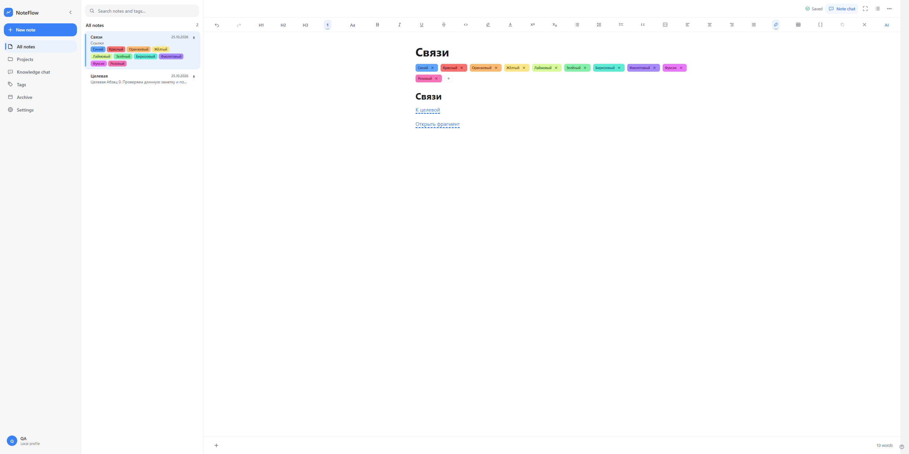

# NoteFlow

**English** | [Русский](README.ru.md)

NoteFlow is a local-first desktop app for notes, with a Markdown-first rich editor, projects, tags, full-text search, and optional AI powered by local or external models. Writing and organizing notes does not require an account or an internet connection.

**Current release: 1.0.0-rc.6.** This is an unsigned Windows Release Candidate, not the final 1.0 release. This README describes the current source code, which includes corrections newer than the RC.6 tag. These changes require a local build until separately validated packages are published; existing RC.6 downloads are unchanged.

## Features

- Rich editing with headings, inline formatting, lists, checklists, quotes, code, links, tables, images, file attachments, callouts and collapsible blocks.
- Automatic saving, revision history, pinned notes, projects, colored tags, archive and focus mode.
- Markdown paste and import. Export individual notes as Markdown, TXT, DOCX or PDF; export projects as ZIP archives.
- SQLite FTS5 search, optional semantic search and knowledge chat with source excerpts and links back to notes.
- AI assistant and note chat using Ollama, LM Studio or an OpenAI-compatible API. Generative and embedding models are configured separately.
- Streaming where supported by the provider, cancellation, and generation that can continue while you switch screens.
- Local backups containing notes, managed attachments, settings and AI/RAG chat history. API keys are excluded.
- Russian and English interface resources, light/dark/system themes, adjustable sidebars and interface zoom. See the [localization validation report](docs/tasks/full-english-localization.md) for the current verification status.

## Screenshots

Screenshots show the browser-rendered application frontend with synthetic QA data, not design mockups. They contain no personal notes or API keys. Native Windows verification is reported separately.




## Platforms

| Platform | Status |
| --- | --- |
| Windows x64 | Release Candidate installers are available. Installer lifecycle tests must be recorded per build; earlier results are not a guarantee for a new package. Windows 10 still needs separate validation. |
| macOS Apple Silicon / Intel | Platform code and build configuration exist, but a signed, notarized production release and native QA are not validated. No public DMG is offered for this RC. |

## Install on Windows

1. Open [GitHub Releases](https://github.com/rubcrish-code/NoteFlow/releases) and select `1.0.0-rc.6`.
2. The recommended installer is **`NoteFlow_1.0.0-rc.6_x64-setup.exe`** (NSIS, per-user installation). English and Russian MSI packages are alternatives for machine-wide installation. Normally, choose one installer type.
3. Optionally compare the download with `SHA256SUMS.txt`, using `Get-FileHash -Algorithm SHA256` in PowerShell.
4. Run the installer and open NoteFlow. Back up important profile data before upgrading.

The RC is **not Authenticode-signed**. Windows SmartScreen may show an unknown-publisher warning. Do not disable Windows security; verify the download source and checksum. Standalone QA EXEs are not the recommended download for everyday use.

See [Installation and builds](docs/en/installation.md) and the [second-PC smoke checklist](docs/release/rc-second-pc-smoke.md).

## AI setup and privacy

Open **Settings → AI models**. Add a connection, enter the server address, retrieve its model list or enter a model ID manually, test the connection, then save. Local Ollama commonly uses `http://127.0.0.1:11434`; use your provider’s actual address and model IDs for other services.

The AI assistant and chats require a generative model. Semantic search additionally requires an embedding model. These are different jobs and can use different connections. Notes and full-text search work without either model.

API keys are stored through Windows Credential Manager or the macOS Keychain integration, not in ordinary SQLite settings, browser storage or backups. macOS production behavior is not yet validated. External providers receive the context needed for a request after the relevant consent. Their retention and privacy policies are outside NoteFlow’s control.

Read [AI configuration](docs/en/ai-configuration.md) and [Security and privacy](docs/en/security-privacy.md).

## Markdown and backups

The single **Markdown (.md)** export uses CommonMark/GFM constructs where available. Extended NoteFlow formatting can use documented Markdown extensions, such as `++underline++` and typed directives for color, font and alignment. Not all external viewers support these extensions. There is no HTML fallback in this export, and unsupported complex content must not be silently flattened.

A `.md` file is **not a complete backup**. Revision history, full metadata, attachment ownership and some complex formatting require a NoteFlow backup. Internal links use `noteflow://note/...` and need the matching note in the local profile. Pasting raw Markdown into Telegram is not a guarantee of formatted text.

See [Markdown support](docs/en/markdown.md) and [Data and backups](docs/en/data-backups.md).

## Run from source

Prerequisites: Node.js with npm, Rust stable, and the native [Tauri prerequisites](https://v2.tauri.app/start/prerequisites/) for your platform. Windows needs MSVC Build Tools and WebView2. macOS needs Xcode Command Line Tools.

```sh
git clone https://github.com/rubcrish-code/NoteFlow.git
cd NoteFlow
npm ci
npm run tauri dev
```

Frontend and Rust checks:

```sh
npm run typecheck
npm run test
npm run build
cd src-tauri
cargo fmt --check
cargo check
cargo test
cargo clippy --all-targets --all-features -- -D warnings
```

Return to the repository root for `npm run tauri build`. A successful build is not proof that installer lifecycle or macOS native QA has passed.

See [Development](docs/en/development.md), [Architecture](docs/en/architecture.md), [Contributing](CONTRIBUTING.md) and [Release process](docs/en/release-process.md).

## Status and limitations

- Still a Release Candidate, not a production-stable 1.0 release.
- No automatic updater or separate retrieval reranker.
- Unsent AI drafts are kept during the current application session, not across app shutdown.
- Streaming depends on provider support.
- macOS native behavior, signing and notarization require validation on a Mac.
- The approved exact tag palette includes four light-theme text/background pairs below WCAG AA for small text; see the [palette report](docs/tasks/classic-vibrant-soft-tags.md).

[Documentation index](docs/en/README.md) · [Troubleshooting](docs/en/troubleshooting.md) · [RC.6 release notes](docs/release/rc-1.0.0-rc.6-notes.md)

Historical reports and design/specification sources are retained. No license grant is implied: this repository currently has no project license file.
